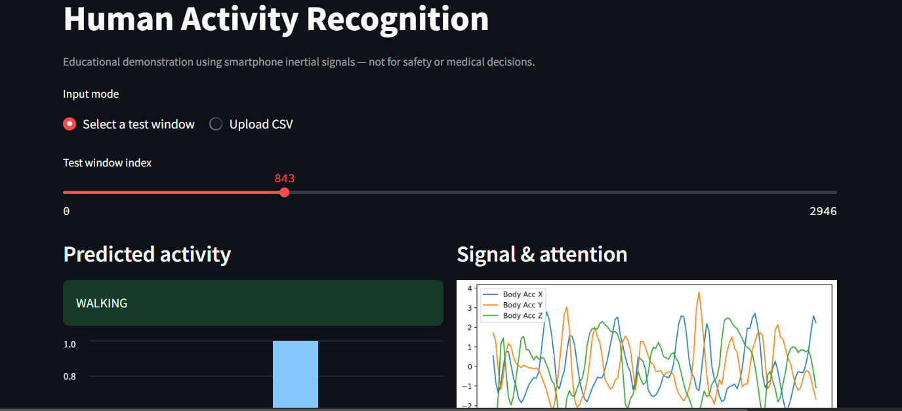

# Human Activity Recognition from Phone Motion Sensors

Applied Machine Learning - Assignment 4

A PyTorch-based Human Activity Recognition system that classifies smartphone motion sensor sequences into six activities using raw inertial signals and a recurrent neural network with temporal attention.

## Activities
1. WALKING
2. WALKING_UPSTAIRS
3. WALKING_DOWNSTAIRS
4. SITTING
5. STANDING
6. LAYING

## Dataset
- UCI Human Activity Recognition Using Smartphones
- 128 time steps per window
- 9 raw inertial sensor channels
- Sampling frequency: 50 Hz
- Window duration: 2.56 seconds
- Subject-based training, validation, and testing
- Validation subjects: 3, 15, 25, and 30
- Standardization statistics computed using training data only
- Raw inertial signals are used instead of the 561 handcrafted features

Dataset:
https://archive.ics.uci.edu/dataset/240/human+activity+recognition+using+smartphones

## Model Architecture
HARNet:

Raw sensor sequence
-> Bidirectional LSTM
-> Temporal Attention Pooling
-> Linear Classification
-> Six Activity Classes

The project also implements a custom RNN cell, custom LSTM cell, LSTM sequence loop, bidirectional LSTM, and temporal attention.

## Training Configuration
- Epochs: 30
- Optimizer: Adam
- Learning rate: 0.001
- Batch size: 64
- Gradient clipping norm: 1.0
- Best checkpoint selected using validation loss
- Trainable parameters: 46,982

## Experimental Results

Overall test accuracy: 93.45%
Test samples: 2,947
Best validation loss: 0.0765

### Per-Class Accuracy

| Activity | Accuracy |
|---|---:|
| WALKING | 97.58% |
| WALKING_UPSTAIRS | 99.58% |
| WALKING_DOWNSTAIRS | 98.81% |
| SITTING | 81.87% |
| STANDING | 84.21% |
| LAYING | 99.81% |

### Analysis

The model performs strongly on walking activities and laying.

The primary challenge is distinguishing SITTING from STANDING because their sensor patterns can be similar.

The confusion matrix shows that 87 sitting samples were classified as standing, while 84 standing samples were classified as sitting.

## Visualizations

Figures include:
- Training and validation loss curves
- Validation accuracy
- Confusion matrix
- Example sensor windows
- Attention examples
- Average attention visualization

Figures are stored in results/figures/.

## Interactive Streamlit Application

The application supports:
- Selecting a test window
- Uploading a CSV sensor window
- Viewing predicted activity
- Viewing six class probability scores
- Visualizing sensor signals
- Visualizing temporal attention

CSV input should contain 128 rows and 9 sensor columns in the expected sensor-channel order.

Run locally:

    pip install -r requirements.txt
    streamlit run app/streamlit_app.py

## Project Structure

HAR_Project/
    app/
    src/
    data/
    docs/
    results/
        best_model.pt
        prepared_data.npz
        test_metrics.json
        per_class_metrics.csv
        training_history.csv
        test_predictions.npz
        attention_summary.csv
        figures/
    requirements.txt
    README.md
    run_all.py

## Execution

    python run_all.py
    python src/train.py
    python src/test_model.py

The workflow includes data preparation, training, validation, test evaluation, and result generation.

## Educational Scope

This is an Applied Machine Learning educational project. It is not intended for medical diagnosis, fall detection, emergency monitoring, or safety-critical decisions.

## Interactive Streamlit Demo

The application provides an interactive interface for exploring Human Activity Recognition predictions.

Users can:
- Select different test samples.
- View predicted activity.
- Explore class probability scores.
- Visualize raw sensor signals.
- Inspect temporal attention weights.

